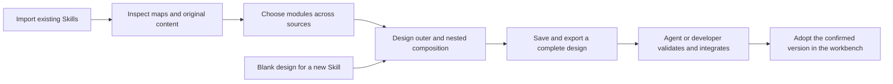

# Skill Workbench · Visual AI Skill Creation

**An infinite canvas for visual AI Skill creation.**

See how existing AI Skills are built, design new ones on a visual canvas, and combine modules from different sources. Export the complete design to your agent or developer for integration.

[中文 / Bilingual overview](README.md) · [Download](https://github.com/jiangzl1986-gif/skill-workbench/releases) · [User guide (Chinese)](docs/USER_GUIDE.md)


<a id="english"></a>
## Why a visual workspace for AI Skills?

Text conversations with an agent are useful for building a Skill. As its rules and files grow, it becomes harder to see which modules exist, where a rule belongs, how two modules should hand off their work, or where a submodule from another Skill should fit.

Skill Workbench gives that process a visible, editable workspace. **Sketch your ideas, inspect the structure, and show exactly where a change belongs.** Use text to explain goals and integration requirements, and the canvas to express module placement, composition and connections.

## What you can create and organize

### 1. Visualize existing Skills before changing them

Import a Skill and explore its knowledge map from the whole Skill down to modules, submodules, files, rules and references. Open a node to read its original content, source and line numbers. Search brings you back to the relevant location.

Inspect an unfamiliar Skill, locate your own rules, or point your agent to the exact module and position you want to change. The structure becomes visible beyond folders and conversation history.

### 2. Design new Skills with modular composition on an infinite canvas

Start with a blank design or load an imported Skill's complete structure. Add modules, zoom and pan, arrange the layout, and draw connections to describe intended handoffs.

Work inside a parent module too: add, replace or remove submodules at specific positions, then connect them internally. Cut an incorrect link while keeping both modules. Plan the structure of a future Skill first, then develop its goals, handoff conditions and integration requirements.

### 3. Reuse modules across Skills in one shared library

Import your existing Skills or external Skills you are permitted to study and reuse, **without first installing them into an agent**. The workbench extracts inspectable structure from files, headings and references, then brings those module candidates into a shared assembly library.

Search across sources and filter by Skill or module level. Each module retains its source Skill, version, file and original content range. Put a module from A into a draft based on B, or combine several sources into a new design, then give your agent the complete design for integration.

### 4. Organize installed Skills, work in progress and future ideas

Import installed Skill directories to inspect their structure. Import development folders to review modules and maintain revision drafts. For a Skill you have not built yet, create a blank design and plan the capabilities and modules it needs.

When a source directory changes, inspect the differences and explicitly adopt a new version. Earlier snapshots and drafts retain their original versions, so both source updates and design dependencies remain traceable.

## From an idea to an integration handoff



For example, add evidence review to a notes-to-outline Skill. Import both Skills, load the outline Skill's structure, enter its outline-design module, and place an evidence-check submodule from the other source at the intended position. Connect it, describe the handoff and save. Give the exported JSON to your agent so it can inspect original rules, versions and placement, resolve interfaces, and implement the confirmed design. Both original Skills remain available.

## Features and practical uses

| Feature | What you can do |
| --- | --- |
| **Knowledge maps** | Explore Skills, modules, files, rules and references; read original content and line numbers, search and locate details. |
| **Infinite-canvas interaction** | Start from a blank design or a complete imported structure; drag modules, zoom and pan to organize a composition. |
| **Nested assembly** | Add, replace or remove submodules at specific parent positions, preserving hierarchy and placement in saved designs. |
| **Connections and scissors** | Drag between ports or click ports in sequence; record handoff intent and cut one link without deleting either module. |
| **Shared module library** | Search every imported source together; filter by Skill and module level, with source, version, file and content-range labels. |
| **Local import and discovery** | Select a directory, choose or drag a complete folder, upload a ZIP, or discover Skills within a directory you specify; preview before adoption. |
| **Version checks and synchronization** | Inspect source changes and explicitly adopt a new version while retaining old snapshots, versions and drafts. |
| **Saved drafts** | Save, reopen and continue editing outer structures or internal submodules. |
| **Complete design exports** | Export original file content, versions, byte checksums, parent positions, connections and integration requirements for an agent or developer. |
| **Maintenance handoffs** | Record change requests, export analysis tasks and generate read-only analysis instructions for an exact registered version. |
| **Release and usage states** | Separate workbench registration, formal release evidence, local installation and actual usage; missing evidence stays unknown. |

Canvas connections express your design. **An executable Skill still requires interface integration, rule checks and independent validation by an agent or developer.** You pass the exported design to your chosen conversation; copying an instruction does not send it or prove usage. Automatically extracted file hierarchies and references are not treated as validated execution flows.

## Getting started — Windows

The current application UI is Chinese. Install **Python 3.11** and **Node.js 22 LTS** first. The workbench itself needs no model API key and makes no paid-service calls.

1. Download the [Windows release archive](https://github.com/jiangzl1986-gif/skill-workbench/releases) and extract it into a separate project directory. The repository's **Code → Download ZIP** source archive also works.
2. Run `setup.cmd` to create an isolated Python environment, install pinned dependencies and build the frontend. Initial setup downloads dependencies from PyPI and npm.
3. Run `start.cmd`. Your browser opens `http://127.0.0.1:8770/`. Use the import-and-sync page to add your own Skill, or try the two public Skills under `examples/` for a cross-source composition.

Keep the launcher running; press `Ctrl+C` to stop. Run `create_shortcut.ps1` to create a desktop shortcut. Detailed instructions and troubleshooting are in the [user guide (Chinese)](docs/USER_GUIDE.md).

Developers can also run:

```powershell
powershell -NoProfile -ExecutionPolicy Bypass -File .\setup.ps1
powershell -NoProfile -ExecutionPolicy Bypass -File .\start.ps1
```

Runtime data defaults to the local `%LOCALAPPDATA%\skill-workbench`, separate from the application and source Skill folders. Use `start.ps1 -Runtime D:\MySkillWorkbenchData -Port 8771` to choose a new, independent local directory and another port.

## Data, licenses and current boundaries

- Imported content stays local and source directories are read-only. The application does not execute imported scripts, automatically install Skills or call model or production APIs.
- Imports and canvas changes retain original content and provenance. Removing a design position does not delete source files or waive original rules, templates or quality requirements.
- The service binds only to `127.0.0.1`, with local-session, cross-site and request checks. It is not currently a public or multi-user server.
- Each source allows up to 5000 files / 32 MiB. Individual files, ZIPs, API requests, complete drafts and final design packages are capped at 2 MiB; outer drafts allow 60 module instances / 120 links, with coordinates within ±20000. Infinite canvas describes zoom, pan and free arrangement; capacity remains bounded. Oversized inputs are rejected without truncation. [Full contract (Chinese)](docs/WORKBENCH_CONTRACT.md)
- [MIT](LICENSE) covers this program. Imported content keeps its original license and reuse permissions. Dependencies retain their licenses; see [third-party notices](THIRD_PARTY_NOTICES.md).

## Validation and future work

Import, source fidelity, outer and nested assembly, saving and export, explicit version adoption and invalid-input rejection were checked in isolated environments on the same Windows computer using public examples; 32 regression checks passed. A second fresh physical computer, other operating systems, arbitrary Skills' business semantics and actual execution have not been validated. [Validation scope (Chinese)](docs/RELEASE_VALIDATION.md)

The internal program identifier `0.1.0-beta.1` supports downloads, updates and traceability. Unified knowledge / experience / evidence libraries, interface-conflict guidance, automatic distribution and actual usage receipts, more platforms and installation improvements remain on the [roadmap (Chinese)](docs/ROADMAP.md); they are not advertised as implemented features.

Share creation scenarios and issues through [GitHub Issues](https://github.com/jiangzl1986-gif/skill-workbench/issues), or submit a Pull Request using the [contribution guide](CONTRIBUTING.md). Use a minimal public example and keep private Skills, accounts, credentials and project materials out of reports.
