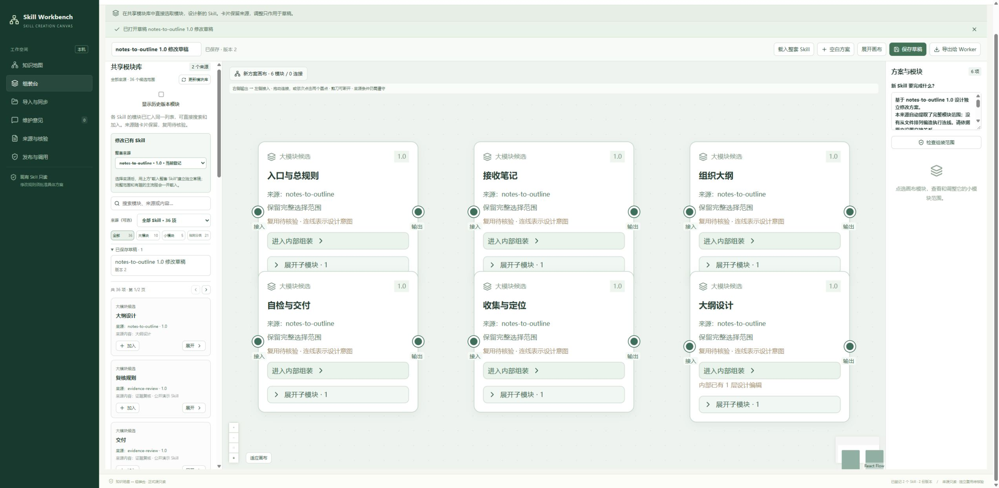

# Skill Workbench

**See how your Skills are built. Design what they can become.**

A local visual workspace for creating, organizing and recombining AI Skills on a zoomable canvas. Import your own Skill folders without installing them into an agent, inspect their knowledge maps, browse modules across sources, and create an inspectable assembly design.

[中文](README.md) · [User guide (Chinese)](docs/USER_GUIDE.md) · [Roadmap](docs/ROADMAP.md)

## Features

- Knowledge maps with source files, heading hierarchies, line references and search.
- A shared module library across imported Skills, with source and version labels.
- Whole-Skill starting points or blank assembly designs.
- Nested editing: add, replace, remove and connect submodules at specific parent positions.
- Zoom, pan, drag, connect and cut individual links without deleting modules.
- Local folder / ZIP ingestion, bounded discovery, explicit import previews and immutable version adoption.
- Draft saving and lossless design exports containing original content and provenance.
- Maintenance handoffs and separate registered / formal / installed / usage states.

This is a **design workbench**. A graph is not proof of an executable workflow. Exported designs require developer integration and independent validation. The application does not execute imported code, install Skills or call model APIs.

## Getting started — Windows beta

Version: **0.1.0-beta.1**. The current UI is Chinese. Install Python 3.11 and Node.js 22 LTS first.

1. Download a release archive or the repository ZIP and extract it.
2. Run `setup.cmd` to install pinned dependencies and build the frontend.
3. Run `start.cmd`. Open `http://127.0.0.1:8770/` and import a folder containing `SKILL.md`, or use the two original examples in `examples/`.

Setup downloads packages from PyPI and npm. Runtime data defaults to `%LOCALAPPDATA%\skill-workbench`; imported content stays local. Press Ctrl+C in the launcher to stop. The source checkout and runtime storage are independent. Do not expose the local service to the Internet.

Each source is bounded to 5000 files / 32 MiB. Individual files, ZIP uploads, API requests and final design packages are limited to 2 MiB; outer drafts allow 60 instances / 120 links. Oversized or unsafe inputs are rejected without truncation.

Tested with isolated Windows environments and public examples. A separate fresh physical machine, other operating systems, arbitrary Skill execution and production semantics are not validated. Knowledge / experience / evidence libraries and automatic usage receipts remain roadmap items.

## Contribute

Open an issue with a minimal public reproducer, or submit a pull request. Please do not upload private Skills or credentials. See [CONTRIBUTING.md](CONTRIBUTING.md).

MIT applies to this program and its original examples. Imported Skills and third-party dependencies retain their own licenses.
