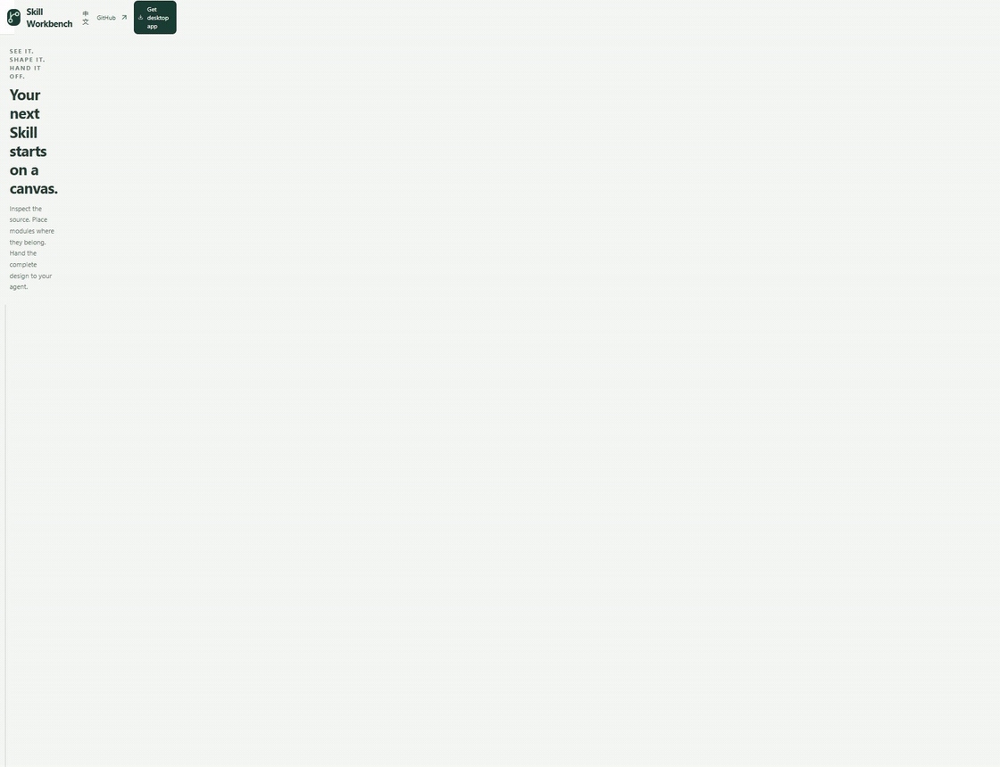
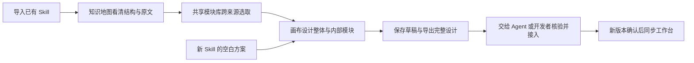
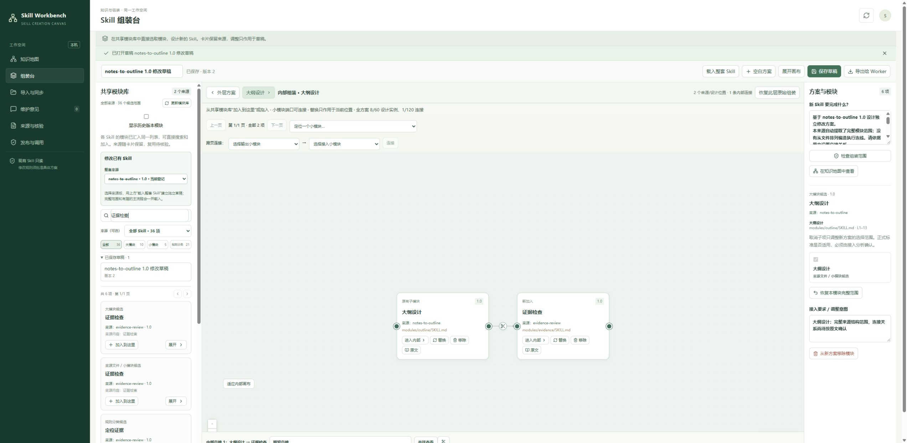
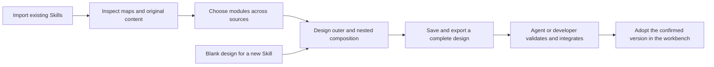

# Skill Workbench · 可视化 Skill 创作工作台

**让 Skill 可视化，让创作过程看得见。**

**An infinite canvas for visual AI Skill creation.**

Skill Workbench 把 Skill 的结构、规则和模块带到可缩放、可平移的画布上。你可以看清已有 Skill，设计新的 Skill，把不同来源的大小模块重新搭配，再将完整设计交给自己的 Agent 或开发者完成接入。

See how existing AI Skills are built, design new ones on a visual canvas, and combine modules from different sources. Export the complete design to your agent or developer for integration.

[**直接在线体验 / Try in your browser →**](https://jiangzl1986-gif.github.io/skill-workbench/) · [**下载 Windows 安装包 / Windows installer**](https://github.com/jiangzl1986-gif/skill-workbench/releases/download/v0.1.0-beta.2/skill-workbench-0.1.0-beta.2-windows-x64-setup.exe) · [**交流与案例 / Discussions**](https://github.com/jiangzl1986-gif/skill-workbench/discussions)

[中文介绍](#中文介绍) · [English on this page](#english) · [English README](README.en.md) · [全部下载 / All downloads](https://github.com/jiangzl1986-gif/skill-workbench/releases) · [使用指南 / User guide](docs/USER_GUIDE.md)

**不用下载安装，先亲手改一个 Skill 设计。** [打开在线画布](https://jiangzl1986-gif.github.io/skill-workbench/)，进入「大纲设计」内部，把另一套 Skill 的「证据检查」加进去，连线、剪线，再导出包含完整原文的设计。上方动图是实际操作截图的步骤回放。

**Try a real edit before installing anything.** [Open the interactive canvas](https://jiangzl1986-gif.github.io/skill-workbench/?lang=en), go inside “Outline design”, add “Evidence check” from another Skill, connect or cut links, and export a source-backed design. The animation replays actual UI steps.

在线示例：中英文界面 · 无需登录 · 两套公开资料 · 草稿保存在自己的浏览器。示例导出用于交给 Agent 评估，不能直接导回桌面版。使用自己的 Skill 请下载完整版。[在线体验说明 / Browser guide](docs/ONLINE_DEMO.md) · [桌面版图文演示 / Desktop walkthrough](docs/TRY_IT.md)

Browser example: Chinese / English UI · No account · Two public sources · Drafts stay in your browser. Example exports are for agent review, not desktop import. Download the full app to import your own Skills.

Windows x64 · 界面中文 / Chinese UI · MIT · 本机运行 / Local-first · **无需另装 Python / Node.js**

如果它让你的 Skill 创作更清楚，欢迎在右上角点 **Star**，方便以后找到。欢迎在 [Discussions](https://github.com/jiangzl1986-gif/skill-workbench/discussions) 分享你的创作场景与可公开案例；可复现的程序问题请提交 [Issue](https://github.com/jiangzl1986-gif/skill-workbench/issues/new/choose)。

If it helps you create Skills, **Star** the repository to find it again. Share public use cases in [Discussions](https://github.com/jiangzl1986-gif/skill-workbench/discussions), or report reproducible bugs through [Issues](https://github.com/jiangzl1986-gif/skill-workbench/issues/new/choose).

## 为什么需要一个可视化的 Skill 工作台

用文字和 Agent 讨论 Skill 很方便，但随着规则和文件变多，你可能很难看清：已经做出了哪些模块？某条规则放在哪里？两个模块怎样交接？把别人的一个小模块接进来，应该放到哪个位置？

Skill Workbench 为这个过程提供一个可见、可修改、可交接的工作空间。**把想法画出来，把结构看清楚，把修改位置说明白。** 文字仍可用于描述目标和接入要求，画布则让你直接表达模块的位置、组合与连接。

## 用它可以怎样创作和整理 Skill

### 1. 让已有 Skill 可视化，先看懂再修改

导入自己的 Skill 后，在知识地图中逐层查看整个 Skill、大模块、小模块、文件、规则与引用。点选节点即可回到原文、行号和来源，搜索内容也能定位到具体位置。

你可以用它梳理一个不熟悉的 Skill、检查自己的规则放在哪里，或在与 Agent 沟通时明确指出“要调整这个模块的这个位置”。Skill 的结构不再只存在于文件目录和聊天记录里。

### 2. 用无限画布做模块化创作，把新的 Skill 画出来

从空白方案开始，或者载入已有 Skill 的整套结构作为起点。拖入模块，缩放和平移画布，调整布局，用连线表达模块之间希望怎样交接。

创作可以深入到大模块内部：在指定位置加入、替换、移除小模块，再连接内部小模块。连错时剪断这条线，保留模块继续调整。你可以先搭出未来 Skill 的结构，再逐步补充目标、交接条件与接入要求。

### 3. 把不同 Skill 的模块放进同一个仓库，重新搭配

导入自己的已有 Skill，或你有权研究和复用的外部 Skill，**不需要先把它安装到 Agent**。工作台会从文件、标题和引用中提取可供检查的模块结构，集中展示在组装台的共享模块库中。

不用在多个 Skill 之间反复切换才能挑选模块：可以跨来源搜索、按来源和大小模块筛选，查看每个模块来自哪个 Skill、哪个版本、哪个文件和原文范围。选出合适的内容，把 A 的模块放进 B 的草稿，或组合成一个新的方案，再交给 Agent 完成实际接入。

### 4. 整理正在使用、正在开发和未来要做的 Skill

对已经安装的 Skill，导入其目录，梳理现有结构；对正在开发的 Skill，导入开发目录，检查模块并维护修改草稿；对未来需要的新 Skill，先创建空白方案，规划它需要哪些能力和模块。

当原目录更新后，可以核对变化、预览新版并明确采用。旧快照与旧草稿保留原来的版本，让“来源已经更新”和“当前方案采用了哪个版本”都可追溯。

## 从想法到开发交接

例如，你想给“笔记转大纲” Skill 增加证据复核能力。先导入它和“证据复核” Skill，载入前者的整套结构，进入“大纲设计”内部，把后者的“证据检查”加入指定位置，连接并写明交接意图。保存设计后，把导出的 JSON 交给自己的 Agent：它可以依据来源原文、版本和你的布局，分析接口与规则，再实施经过确认的方案。两份原 Skill 都保留。

## 具体功能

| 功能 | 你可以做什么 |
| --- | --- |
| **知识地图** | 逐层查看 Skill、模块、文件、规则和引用；读取原文与行号，搜索并定位内容。 |
| **无限画布交互** | 创建空白方案或载入整套结构；拖拽布局、缩放、平移，在同一空间组织多个模块。 |
| **内部组装** | 进入大模块，在具体父子位置加入、替换、移除小模块；保存时保留层级与位置。 |
| **连线与剪线** | 用端口拖拽或依次点选连接，填写交接意图；单独剪断错误的线，保留两端模块。 |
| **共享模块库** | 集中搜索所有已导入来源；按 Skill 和模块层级筛选，查看来源、版本、文件及原文范围。 |
| **本机导入与发现** | 指定目录、选择或拖入完整文件夹、上传 ZIP；在你指定的目录查找 Skill，预览后选择接入。 |
| **版本核对与同步** | 核对来源变化，预览并明确采用新版；旧快照、旧版本与旧草稿保留。 |
| **草稿保存与继续编辑** | 保存方案、重新打开，并继续调整整体结构或内部小模块。 |
| **完整设计包导出** | 导出原文件内容、来源版本、字节校验、父子位置、连线及接入要求，交给 Agent 或开发者。 |
| **维护交接** | 记录维护意见、导出分析任务，生成指向准确登记版本的只读分析指令。 |
| **发布与调用状态** | 分别查看工作台登记、正式发布凭证、本机安装和实际使用；没有凭证时显示未知。 |

画布上的连线表达你的设计。**实际可执行的 Skill 仍需要 Agent 或开发者完成接口接入、规则核验和独立验证。** 工作台导出完整设计，由你交给目标对话框；复制指令不会自动发送或证明已经调用。自动提取的文件层级和引用也不会被当成已经验证的执行流程。

## 快速开始（Windows）

第一次体验可跟随 [公开示例图文演示](docs/TRY_IT.md)；无需先准备自己的 Skill，也无需模型账号。

1. 下载 [Windows 安装包](https://github.com/jiangzl1986-gif/skill-workbench/releases)，选择 **windows-x64-setup.exe**。
2. 双击安装程序，点击 **Install**；完成后打开 **Skill Workbench**，浏览器会自动显示工作台。以后可从桌面或开始菜单打开。
3. 到“导入与同步”选择自己的 Skill，或先用安装目录 `examples` 中的两个公开示例体验跨来源组装。

**不需要自己安装 Python、Node.js，不需要运行 setup，也不需要联网安装依赖。** 当前支持 Windows x64，工作台界面为中文，安装向导为英文。使用时保留启动窗口，点 **退出工作台** 正常停止服务。

不想安装时，可选 **windows-x64-portable.zip**，完整解压后双击 **启动工作台.exe**；保留旁边的 `_internal` 文件夹。安装程序和 EXE 暂未取得 Windows 数字签名。

资料默认保存在本机 `%LOCALAPPDATA%\skill-workbench`，与程序目录和 Skill 原来源分开。[免安装说明](docs/WINDOWS_PORTABLE.md) · [详细使用指南](docs/USER_GUIDE.md)

**源码开发者**：原源码方式继续保留，需 Python 3.11 与 Node.js 22 LTS；运行 `setup.cmd` 准备后，再运行 `start.cmd`。启动参数与开发细节见使用指南。

## 数据、许可与当前边界

- 导入资料留在本机，原来源只读。程序不执行导入的脚本、不自动安装 Skill、不调用模型或生产 API。
- 导入和画布修改保留原文与来源。移除设计位置不会删除源文件，也不会自动豁免原规则、模板和质量要求。
- 服务只监听 `127.0.0.1`，包含本机会话、跨站访问与请求校验；当前不作为公网或多人服务器使用。
- 每个来源最多 5000 文件 / 32 MiB；单文件、ZIP、API 请求、完整草稿及最终设计包最多 2 MiB；顶层最多 60 模块实例 / 120 连线，坐标范围 ±20000。无限画布描述缩放、平移和自由布局的交互，容量仍有明确边界。超限会拒绝，不截断资料。[完整契约](docs/WORKBENCH_CONTRACT.md)
- 程序采用 [MIT](LICENSE)。导入内容的原许可和复用权限继续有效；依赖许可见 [第三方说明](THIRD_PARTY_NOTICES.md)。

## 验证范围与后续计划

已在同一台 Windows 电脑的独立环境和公开示例上验证导入、来源保真、整体与内部组装、保存导出、版本采用和错误拒绝，32 个回归测试项通过。第二台全新电脑、其他操作系统、任意 Skill 的业务语义及实际执行尚未验证。[验收范围](docs/RELEASE_VALIDATION.md)

当前程序版本标识 `0.1.0-beta.2` 用于下载、更新与追溯。知识 / 经验 / 证据库、接口冲突提示、自动分发与实际调用回执、更多平台和安装体验列入 [路线图](docs/ROADMAP.md)，目前不作为已实现能力宣传。

欢迎通过 [Issues](https://github.com/jiangzl1986-gif/skill-workbench/issues) 分享创作场景、反馈问题，或按 [贡献指南](CONTRIBUTING.md) 提交 Pull Request。请使用可公开的最小示例，保留自己的私人 Skill、账号、密钥和项目资料。

---

## Why a visual workspace for AI Skills?

Text conversations with an agent are useful for building a Skill. As its rules and files grow, it becomes harder to see which modules exist, where a rule belongs, how two modules should hand off their work, or where a submodule from another Skill should fit.

Skill Workbench gives that process a visible, editable workspace. **Sketch your ideas, inspect the structure, and show exactly where a change belongs.** Use text to explain goals and integration requirements, and the canvas to express module placement, composition and connections.

## What you can create and organize

### 1. Visualize existing Skills before changing them

Import a Skill and explore its knowledge map from the whole Skill down to modules, submodules, files, rules and references. Open a node to read its original content, source and line numbers. Search brings you back to the relevant location.

Inspect an unfamiliar Skill, locate your own rules, or point your agent to the exact module and position you want to change. The structure becomes visible beyond folders and conversation history.

### 2. Design new Skills with modular composition on an infinite canvas

Start with a blank design or load an imported Skill's complete structure. Add modules, zoom and pan, arrange the layout, and draw connections to describe intended handoffs.

Work inside a parent module too: add, replace or remove submodules at specific positions, then connect them internally. Cut an incorrect link while keeping both modules. Plan the structure of a future Skill first, then develop its goals, handoff conditions and integration requirements.

### 3. Reuse modules across Skills in one shared library

Import your existing Skills or external Skills you are permitted to study and reuse, **without first installing them into an agent**. The workbench extracts inspectable structure from files, headings and references, then brings those module candidates into a shared assembly library.

Search across sources and filter by Skill or module level. Each module retains its source Skill, version, file and original content range. Put a module from A into a draft based on B, or combine several sources into a new design, then give your agent the complete design for integration.

### 4. Organize installed Skills, work in progress and future ideas

Import installed Skill directories to inspect their structure. Import development folders to review modules and maintain revision drafts. For a Skill you have not built yet, create a blank design and plan the capabilities and modules it needs.

When a source directory changes, inspect the differences and explicitly adopt a new version. Earlier snapshots and drafts retain their original versions, so both source updates and design dependencies remain traceable.

## From an idea to an integration handoff

For example, add evidence review to a notes-to-outline Skill. Import both Skills, load the outline Skill's structure, enter its outline-design module, and place an evidence-check submodule from the other source at the intended position. Connect it, describe the handoff and save. Give the exported JSON to your agent so it can inspect original rules, versions and placement, resolve interfaces, and implement the confirmed design. Both original Skills remain available.

## Features and practical uses

| Feature | What you can do |
| --- | --- |
| **Knowledge maps** | Explore Skills, modules, files, rules and references; read original content and line numbers, search and locate details. |
| **Infinite-canvas interaction** | Start from a blank design or a complete imported structure; drag modules, zoom and pan to organize a composition. |
| **Nested assembly** | Add, replace or remove submodules at specific parent positions, preserving hierarchy and placement in saved designs. |
| **Connections and scissors** | Drag between ports or click ports in sequence; record handoff intent and cut one link without deleting either module. |
| **Shared module library** | Search every imported source together; filter by Skill and module level, with source, version, file and content-range labels. |
| **Local import and discovery** | Select a directory, choose or drag a complete folder, upload a ZIP, or discover Skills within a directory you specify; preview before adoption. |
| **Version checks and synchronization** | Inspect source changes and explicitly adopt a new version while retaining old snapshots, versions and drafts. |
| **Saved drafts** | Save, reopen and continue editing outer structures or internal submodules. |
| **Complete design exports** | Export original file content, versions, byte checksums, parent positions, connections and integration requirements for an agent or developer. |
| **Maintenance handoffs** | Record change requests, export analysis tasks and generate read-only analysis instructions for an exact registered version. |
| **Release and usage states** | Separate workbench registration, formal release evidence, local installation and actual usage; missing evidence stays unknown. |

Canvas connections express your design. **An executable Skill still requires interface integration, rule checks and independent validation by an agent or developer.** You pass the exported design to your chosen conversation; copying an instruction does not send it or prove usage. Automatically extracted file hierarchies and references are not treated as validated execution flows.

## Getting started — Windows

For your first session, follow the [public-example walkthrough](docs/TRY_IT.md#english). You do not need your own Skill or a model account to try the workbench.

1. Download the [Windows installer](https://github.com/jiangzl1986-gif/skill-workbench/releases), choosing **windows-x64-setup.exe**.
2. Double-click it and choose **Install**. Open **Skill Workbench** when finished; your browser opens automatically. Desktop and Start menu shortcuts are available for later use.
3. Import your Skill through “导入与同步”, or try the two public examples in the installed `examples` folder.

**No separate Python, Node.js, setup command or online dependency installation is needed.** The package targets Windows x64; the workbench UI is Chinese and the installer wizard is English. Keep the launcher open and click **退出工作台** to stop the service.

For a portable option, download **windows-x64-portable.zip**, extract the complete archive and double-click **启动工作台.exe**. Keep `_internal` beside the EXE. The installer and app are currently unsigned.

Data defaults to the local `%LOCALAPPDATA%\skill-workbench`, separate from the program and original Skill directories. [Portable instructions](docs/WINDOWS_PORTABLE.md) · [Detailed user guide (Chinese)](docs/USER_GUIDE.md)

**Source developers**: the original source installation remains available. Install Python 3.11 and Node.js 22 LTS, run `setup.cmd`, then `start.cmd`. See the user guide for startup parameters and development details.

## Data, licenses and current boundaries

- Imported content stays local and source directories are read-only. The application does not execute imported scripts, automatically install Skills or call model or production APIs.
- Imports and canvas changes retain original content and provenance. Removing a design position does not delete source files or waive original rules, templates or quality requirements.
- The service binds only to `127.0.0.1`, with local-session, cross-site and request checks. It is not currently a public or multi-user server.
- Each source allows up to 5000 files / 32 MiB. Individual files, ZIPs, API requests, complete drafts and final design packages are capped at 2 MiB; outer drafts allow 60 module instances / 120 links, with coordinates within ±20000. Infinite canvas describes zoom, pan and free arrangement; capacity remains bounded. Oversized inputs are rejected without truncation. [Full contract (Chinese)](docs/WORKBENCH_CONTRACT.md)
- [MIT](LICENSE) covers this program. Imported content keeps its original license and reuse permissions. Dependencies retain their licenses; see [third-party notices](THIRD_PARTY_NOTICES.md).

## Validation and future work

Import, source fidelity, outer and nested assembly, saving and export, explicit version adoption and invalid-input rejection were checked in isolated environments on the same Windows computer using public examples; 32 regression checks passed. A second fresh physical computer, other operating systems, arbitrary Skills' business semantics and actual execution have not been validated. [Validation scope (Chinese)](docs/RELEASE_VALIDATION.md)

The internal program identifier `0.1.0-beta.2` supports downloads, updates and traceability. Unified knowledge / experience / evidence libraries, interface-conflict guidance, automatic distribution and actual usage receipts, more platforms and installation improvements remain on the [roadmap (Chinese)](docs/ROADMAP.md); they are not advertised as implemented features.

Share creation scenarios and issues through [GitHub Issues](https://github.com/jiangzl1986-gif/skill-workbench/issues), or submit a Pull Request using the [contribution guide](CONTRIBUTING.md). Use a minimal public example and keep private Skills, accounts, credentials and project materials out of reports.
