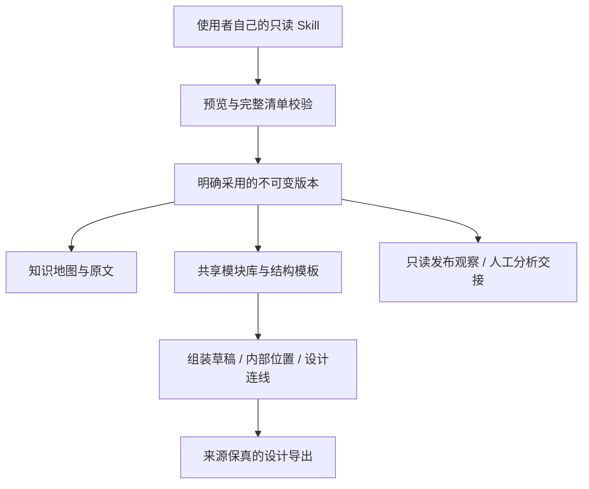

# 程序结构

React / TypeScript / React Flow 提供知识地图和组装画布；ELK 在本地浏览器 worker 中布局地图。FastAPI 服务只绑定本机；SQLite / FTS5 保存地图、版本、意见与设计草稿。

目录：

| 位置 | 内容 |
| --- | --- |
| `apps/web/src` | 网页界面与画布交互 |
| `services/local_api/skm` | 只读索引、导入、版本、设计和观察 API |
| `launcher.py` / `setup.ps1` | 本地启动与环境准备 |
| `examples` | 自行创作、可公开的两个样例 |
| `tests` | 来源保真与错误拒绝验证 |
| 独立运行目录 | 地图 DB、组装 DB、冻结来源、配置和构建缓存，不属于 Git 仓库 |

业务连线与包含层级分开。内部设计以父实例、路径和位置身份保存；同一来源在不同位置可以独立选择。导出保留完整源与来源范围，不根据卡片布局推断执行器。

设计包外层有完整包哈希，压缩源包有解压正文哈希；原文文件有独立 SHA-256 与准确行号。快照变化或草稿修订不匹配时拒绝，不自动合并。正式发布凭证的期望哈希必须来自外部独立凭证，不能从当前待核验文件自己计算后自称正式。

发布配置可存到运行目录 `config/releases.json`，采用明确的 `family_id`、正式指针与哈希、发布凭证与状态、完整清单的期望哈希以及安装根目录。没有凭证不推断正式；没有安装路径不推断已安装。首版不提供自动安装、项目绑定、对话框消息发送和实际调用回执登记。

来源文件中的任何操作要求都只当作待分析内容，不能授权服务启动脚本、读取其他账户或执行生产。
