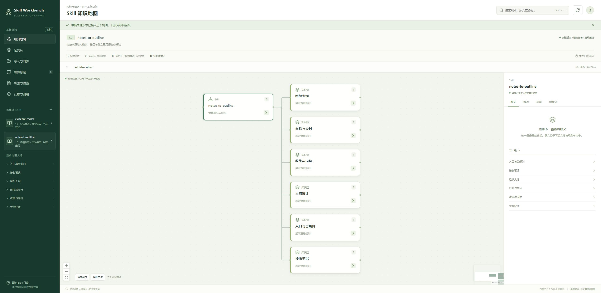
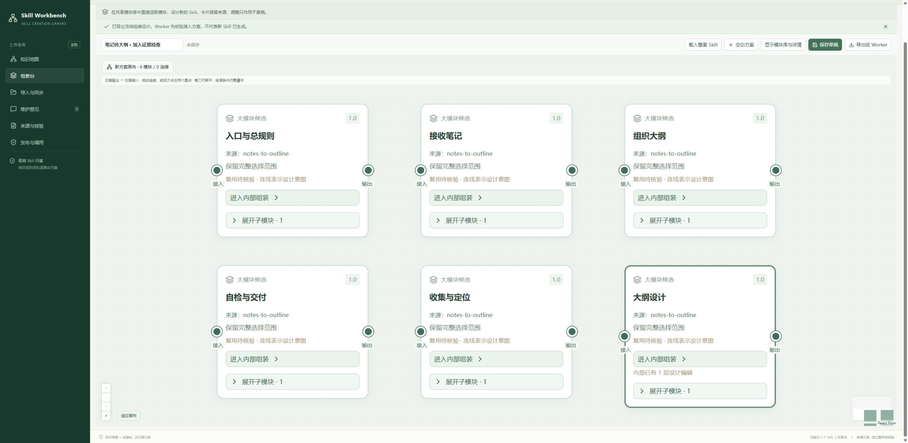
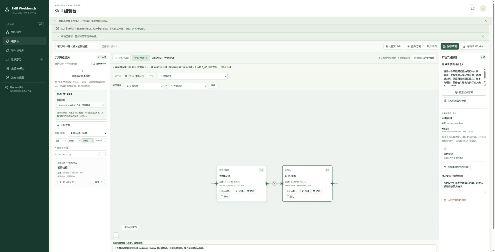

# 跟着公开示例，完成第一次 Skill 组装

[English walkthrough](#english) · [回到项目首页](../README.md) · [下载 Windows 安装包](https://github.com/jiangzl1986-gif/skill-workbench/releases/download/v0.1.0-beta.2/skill-workbench-0.1.0-beta.2-windows-x64-setup.exe)

这次体验的目标：**给“笔记转大纲”设计一个来自另一份 Skill 的“证据检查”模块。** 看清它来自哪里、加入哪一层、希望怎样交接，再导出设计交给自己的 Agent。示例为本项目编写并采用 MIT，不包含私人 Skill。

本页三张程序截图来自已发布的 Windows 程序，演示环境只导入下列两个公开示例。页面里的连接是设计意图；导出不会自动生成或安装新 Skill。

## 1. 下载后打开工作台

下载 `windows-x64-setup.exe`，双击，点击 **Install**。打开 **Skill Workbench**，浏览器会显示工作台。以后可从桌面或开始菜单打开；使用时保留启动窗口。

不需要自己安装 Python 或 Node.js，也不需要模型账号。当前支持 Windows x64；安装向导为英文，工作台界面为中文。

默认安装目录是 `%LOCALAPPDATA%\Programs\Skill Workbench`。可以在资源管理器地址栏输入该路径，找到 `examples` 文件夹；如果安装时选择了别的位置，就到所选目录找 `examples`。便携包的 `examples` 在解压后的程序目录中。

## 2. 把两个示例加入工作台

打开左侧 **导入与同步**，逐个导入下面的完整文件夹：

| 文件夹 | 内容 | 这次用它做什么 |
| --- | --- | --- |
| `examples/notes-to-outline` | 笔记转大纲 | 作为要修改的方案起点。 |
| `examples/evidence-review` | 证据复核 | 提供要加入的证据检查模块。 |

可以点击 **选择文件夹**，也可以把完整文件夹拖进来源区域。每份来源都先点 **预览完整来源与模块**，核对名称、版本和文件清单，再点 **确认这份预览并接入**。

两份示例会进入知识地图、共享模块库和整套方案来源，无需安装到 Agent。原文件保留。

## 3. 看清原来的结构

打开 **知识地图**，选择 `notes-to-outline`。单击查看内容，双击或点击展开按钮进入下一层；选择具体文件或规则可查看原文与行号。来源结构和规则候选不等于已经验证的执行流程。

## 4. 载入整套方案，进入大模块内部

打开 **组装台**。在共享模块库的 **修改已有 Skill → 整套来源** 选择 `notes-to-outline · 1.0`，点顶部 **载入整套 Skill**。工作台建立独立修改草稿。

卡片可以拖动整理位置。下面展示同一演示草稿的外层视图；卡片间距已在画布上手动调整，内部修改仍随草稿保留。

在 **大纲设计** 卡片上点 **进入内部组装**。如果共享模块库隐藏了，点顶部 **显示模块库与详情**。此时加入的是当前大模块内部的位置。

## 5. 加入另一份 Skill 的小模块，并连接

1. 在共享模块库搜索 **证据检查**，切换到 **小模块**。
2. 找到来源为 `evidence-review · 1.0`、文件为 `modules/evidence/SKILL.md` 的卡片，点 **加入到这里**。
3. 内部画布显示原有的“大纲设计”和新加入的“证据检查”，每张卡片保留来源。
4. 将“证据检查”的输出端口连到“大纲设计”的接入端口。也可在 **内部连接起点** 选择“证据检查”，在 **内部连接终点** 选择“大纲设计”，点 **连接**。
5. 给连线写清交接意图，例如：先检查证据与缺失项，再把带定位依据的复核结果交给大纲设计；具体字段与冲突由 Agent 接入时核验。

连错时，点线上的 **剪刀** 或连线列表的移除按钮，保留两端模块继续调整。已有连接时，先剪断涉及该项的连线，再替换或移除小模块。

## 6. 保存，并把完整设计交给 Agent

填写 **方案名称**、**新 Skill 要完成什么**、当前位置的调整意图和连线条件。点 **保存草稿**，再点 **导出给 Worker** 下载完整 JSON。

导出的设计包含来源原文、版本、校验、内部父子位置和连线。把它交给你选择的 Agent 或开发者，说明希望实现的修改，让对方先检查来源、输入输出和规则冲突，再实施经过确认的接入。**本次体验到此完成设计交接；实际执行需要另外验证。**

## 常见疑问

| 问题 | 回答 |
| --- | --- |
| 需要模型账号、API Key 或 Agent 插件吗？ | 工作台本身不需要，也不会调用付费模型服务。实际开发接入可使用你已有的 Agent。 |
| 能导入别人写的 Skill 吗？ | 可以导入完整目录或 ZIP；研究、复制和复用仍需符合来源许可。 |
| 会改坏原 Skill 吗？ | 导入和画布设计使用独立快照与草稿，原来源只读。 |
| 导出后能直接运行新 Skill 吗？ | 导出是完整设计交接包。执行能力需由 Agent 或开发者接入并验证。 |
| 没有自动出现连线，是导入失败了吗？ | 否。工作台保留结构，不把文件排列猜成执行顺序。没有原文依据的交接由你设计。 |
| 可以在 Mac、Linux 或多人公网服务上使用吗？ | 当前发布的是 Windows x64 本机程序。其他平台与多人服务未验证。 |

使用中卡住了，带上公开的最小复现步骤到 [Issues](https://github.com/jiangzl1986-gif/skill-workbench/issues/new/choose)。想讨论自己的创作方法、未来能力或公开案例，欢迎到 [Discussions](https://github.com/jiangzl1986-gif/skill-workbench/discussions)。如果工作台对你有用，可以在仓库右上角点 **Star** 收藏。

---

## Your first cross-Skill composition

**Goal: add evidence checking from one Skill inside a notes-to-outline Skill.** Inspect its provenance and placement, describe the intended handoff, then export the design to your own agent. Both examples were written for this project and are MIT licensed.

The screenshots above are from the released Windows application using only these two public examples. Connections express design intent; exporting does not automatically create or install an executable Skill.

1. **Install and open.** Download the [Windows x64 installer](https://github.com/jiangzl1986-gif/skill-workbench/releases/download/v0.1.0-beta.2/skill-workbench-0.1.0-beta.2-windows-x64-setup.exe), double-click and choose **Install**. Open **Skill Workbench** from the desktop or Start menu. Keep the launcher window open. No separate Python, Node.js or model account is needed. The application UI is Chinese; the installer is English.
2. **Find the examples.** The default program directory is `%LOCALAPPDATA%\Programs\Skill Workbench`. Open its `examples` folder. If you selected another installation directory, look there. For the portable package, use the extracted program directory.
3. **Import both complete folders.** In **导入与同步** (Import and sync), choose `examples/notes-to-outline`, preview the complete source and confirm adoption. Repeat for `examples/evidence-review`. Folder selection, folder drag-and-drop and ZIP import are supported. Neither example needs to be installed into an agent.
4. **Inspect the map.** In **知识地图** (Knowledge map), select `notes-to-outline`. Open nodes to see the structure and original content. File and rule nodes provide source text and line numbers. Extracted structure is not a validated execution flow.
5. **Load an independent draft.** In **组装台** (Assembly), select `notes-to-outline · 1.0` under **修改已有 Skill → 整套来源**, then click **载入整套 Skill** (Load entire Skill).
6. **Enter the parent.** On the **大纲设计** (Outline design) card, click **进入内部组装** (Enter internal assembly). If the module library is hidden, click **显示模块库与详情** (Show library and details).
7. **Add the submodule.** Search **证据检查** (Evidence check), select **小模块** (Submodules), and choose the card from `evidence-review · 1.0`, file `modules/evidence/SKILL.md`. Click **加入到这里** (Add here).
8. **Connect and describe.** Connect the evidence-check output to the outline-design input. Alternatively choose those modules in **内部连接起点** and **内部连接终点**, then click **连接**. Describe the handoff: review evidence and missing items first, then pass a locatable review result to outline design; the agent must check fields and conflicts during integration. Cut an incorrect connection with its scissors button. Disconnect links involving a submodule before replacing or removing it.
9. **Save and export.** Fill in the design name, goal, placement intent and link conditions. Click **保存草稿** (Save draft) and **导出给 Worker** (Export to worker). Give the complete JSON design to your agent or developer for source checks, interface integration and independent validation.

The source files stay read-only. Imported content remains local. The workbench does not run imported scripts, call paid models or prove a new Skill executes correctly. Third-party Skills retain their original licenses and reuse permissions. Other operating systems and public multi-user hosting are not validated.

Use [Issues](https://github.com/jiangzl1986-gif/skill-workbench/issues/new/choose) for reproducible bugs, and [Discussions](https://github.com/jiangzl1986-gif/skill-workbench/discussions) for questions, ideas and public showcases. **Star** the repository if it helps you and you want to find it again.
